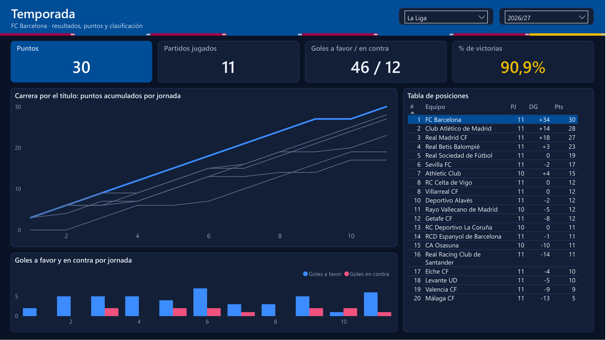
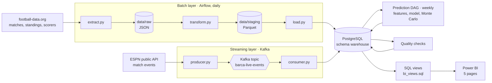
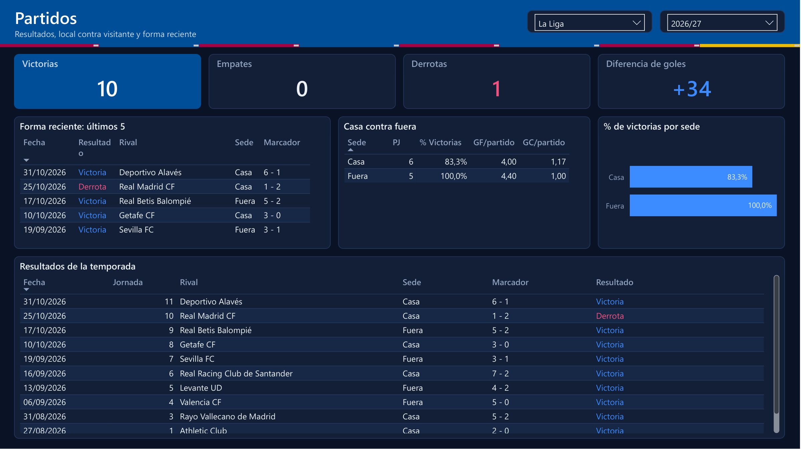
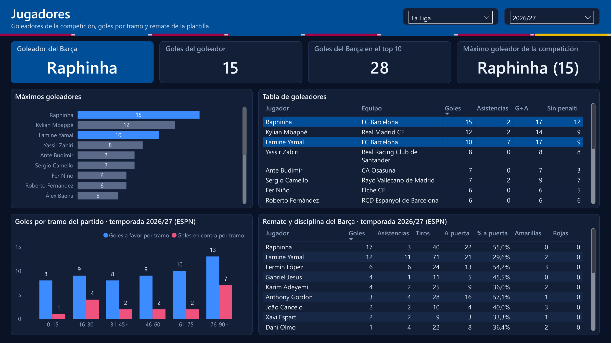
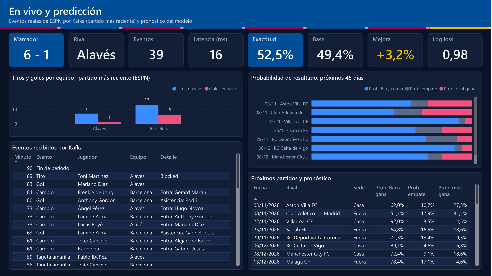
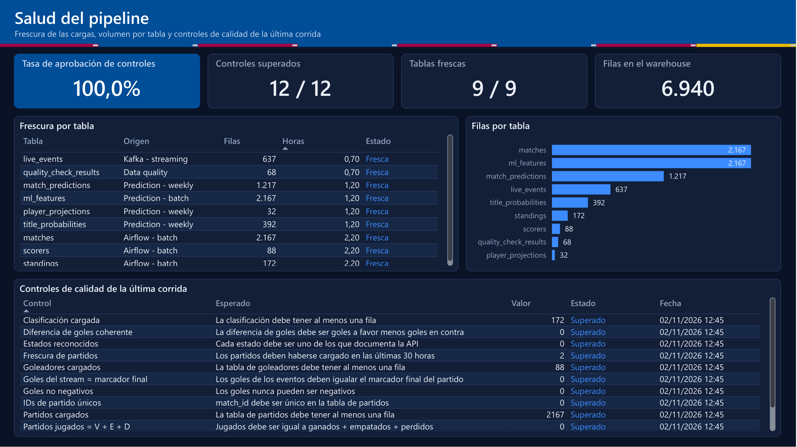

# Barça Data Pipeline

An end-to-end data engineering project built on real FC Barcelona data: a daily **batch** pipeline, a **streaming** layer for match events, a **machine-learning** module that forecasts results, a PostgreSQL **warehouse**, and a **Power BI** dashboard on top. Everything runs locally with Docker Compose and costs nothing.



## What it does

| Layer | What happens | Tools |
|---|---|---|
| **Batch** | Every day an Airflow DAG extracts La Liga and Champions League matches, standings and scorers from football-data.org, stores the raw JSON, transforms it to Parquet and upserts it into the warehouse. | Airflow, pandas, Parquet, PostgreSQL |
| **Streaming** | A producer publishes real match events (goals, shots, cards, substitutions) from ESPN to Kafka. A consumer writes them to the warehouse idempotently. It can replay a finished match, backfill the season, or follow a match in progress. | Kafka, Python |
| **Prediction** | A logistic-regression model scores every pending fixture. A Poisson model and a Monte Carlo simulation turn those probabilities into title chances. | scikit-learn, NumPy |
| **Quality** | Twelve post-load checks run after every load and are stored, so the dashboard can show their history. | Python, SQL |
| **Reporting** | SQL views feed a Power BI model and five report pages. | PostgreSQL, Power BI (PBIP/PBIR + TMDL) |

## Architecture



## The dashboard

Five pages in a dark Barcelona palette. The report is stored as a **Power BI project** (`.pbip`): the model as TMDL and every page as PBIR JSON, so both can be reviewed in a pull request.

| Page | Answers |
|---|---|
| **Temporada** | How is the season going? Points, goals, win rate, the title race against the direct rivals and the full table. |
| **Partidos** | Results, home against away, and the last five matches. |
| **Jugadores** | Top scorers of the competition, when Barcelona scores and concedes, and each player's finishing and discipline. |
| **En vivo y predicción** | The latest streamed match and the model's forecast for the next fixtures, with its accuracy against a baseline. |
| **Salud del pipeline** | Freshness and size of every table and the result of each quality check. This page is about the pipeline itself. |

| | |
|---|---|
|  |  |
|  |  |

Power BI reads **views, never base tables** (`sql/views/bi_views.sql`). A `.pbix` is a binary file, so logic written inside it never appears in a diff; logic in a SQL view does. Every view carries a `comp_season_key` so one competition slicer and one season slicer filter the whole report through a single dimension table.

## Quick start

**Requirements:** Docker Desktop, Python 3.11, Power BI Desktop (Windows) for the report.

```bash
git clone <this repository>
cd barca-data-pipeline
cp .env.example .env          # then fill in API_KEY_FOOTBALL and the passwords
docker compose up -d postgres airflow-init airflow-webserver airflow-scheduler
```

Get a free API key at [football-data.org](https://www.football-data.org/client/register) and put it in `.env`.

### 1. Batch layer

Open Airflow at <http://localhost:8080> and trigger `barca_etl_pipeline`, or run it from the terminal:

```bash
docker exec barca-airflow-scheduler airflow dags unpause barca_etl_pipeline
docker exec barca-airflow-scheduler airflow dags trigger barca_etl_pipeline
```

### 2. Database objects

The ETL creates the batch tables. Then apply the migrations in order and the reporting views:

```bash
for f in sql/migrations/*.sql; do
  docker exec -i barca-postgres psql -U <user> -d barca_warehouse < "$f"
done
docker exec -i barca-postgres psql -U <user> -d barca_warehouse < sql/views/bi_views.sql
```

The migrations are the project's history, written to upgrade an existing database in small, reversible steps (expand → migrate → contract). `bi_views.sql` can be re-applied at any time.

### 3. Prediction layer

```bash
docker exec barca-airflow-scheduler airflow dags trigger barca_ml_predictions
```

The model is trained with `scripts/train_model.py`; the serialised file is not committed, but its metadata is (`models/match_outcome_lr_v1_metadata.json`).

### 4. Streaming layer

```bash
docker compose up -d zookeeper kafka consumer
docker compose run --rm producer --list-matches        # Barcelona's matches
docker compose run --rm producer --backfill            # load the whole season
docker compose run --rm producer                       # replay the latest match at 60x
docker compose run --rm producer --live --wait         # follow a match as it is played
```

Kafka UI is at <http://localhost:8081>.

### 5. Dashboard

Start PostgreSQL, then open `powerbi/barca_dashboard.pbip` in Power BI Desktop and choose **Refresh**. The model connects to `localhost:15432`.

The report pages are generated by the scripts in `powerbi/tools/`:

```bash
cd powerbi/tools
python build_all.py        # regenerate the five pages
python validate_pbir.py ../barca_dashboard.Report/definition/pages/<page id>   # check against Microsoft's JSON schema
python check_fields.py     # every field a visual uses must exist in the model
python export_screenshots.py <report.pdf>   # File > Export > Export to PDF in Power BI, then crop to PNGs
```

### Tests

```bash
pip install -r requirements-dev.txt
python -m pytest tests
```

## Data quality

Two kinds of checks, deliberately separate:

* **Before the write** (`scripts/load.py`): is this batch safe to load? Null keys and impossible values stop the load.
* **After the write** (`scripts/quality.py`): is the warehouse coherent now? Twelve checks cover presence, freshness, key uniqueness, arithmetic (played = won + drawn + lost, goal difference) and business rules. Each run is stored in `warehouse.quality_check_results` and shown on the health page.

One check compares **two independent sources**: the goals in the ESPN event stream must equal the final score from football-data.org. It exists because the first version of the stream mapping dropped about a third of the season's goals. ESPN labels them "Goal - Header", "Goal - Free-kick" or "Penalty - Scored", and only the plain "Goal" was recognised. The mismatch showed up as 6 of 14 matches disagreeing, was fixed, and is now verified on every run (14 of 14 agree).

## The prediction model

`match_outcome_lr_v1` is a logistic regression over 27 features: Elo ratings, recent form, head-to-head record and competition phase. It was selected for the lowest log loss on a held-out season.

| Held-out season 2025 | Accuracy | Log loss |
|---|---|---|
| Baseline (always predict the home side) | 49.4 % | 18.24 |
| **Logistic regression (used)** | **52.5 %** | **0.98** |
| XGBoost | 50.3 % | 1.04 |

A 3-point accuracy gain over a naive baseline is modest, and the dashboard shows it as such. Football results are noisy, so the model is better judged by its calibrated probabilities (log loss) than by how often its top pick wins. Two assumptions are explicit in `scripts/predict.py`: team ratings are frozen across a simulated season, and knockout draws are random among eligible teams.

## Design decisions worth knowing

* **Idempotent everywhere.** Upserts in the batch layer; a deterministic event id (a UUID derived from the provider's play id) plus `ON CONFLICT DO NOTHING` in the stream. Replaying a match or restarting a consumer cannot duplicate a row.
* **Event time kept apart from processing time.** Every event carries when it happened (`event_ts`), when it was published (`produced_at`) and when it was stored (`ingested_at`). Their difference is the pipeline's end-to-end latency, shown on the dashboard.
* **Identifiers, not names.** Tables are keyed on API ids. Matching Barcelona by name silently included RCD Espanyol de Barcelona once; the views use `team_id = 81`.
* **Expand → migrate → contract** for schema changes, so a running report keeps refreshing while the model changes.
* **Append-only predictions.** A probability is a statement about a moment; overwriting yesterday's would hide the movement the report exists to show.
* **Reproducible reports.** Pages are generated from code and checked against Microsoft's published schema and against the model, instead of being edited by hand in a binary file.

## Limitations

* **ESPN is an unofficial API.** It needs no key, but it is undocumented and can change without notice. It is a reasonable source for a portfolio pipeline and not a foundation for anything critical. The parser is defensive and covered by offline tests.
* **No expected goals (xG) for the current season.** Free sources do not provide it. football-data.org's free tier returns only half-time and full-time scores, and the StatsBomb open data stops at the 2020/21 season. The pipeline originally replayed a 2020/21 StatsBomb match; it was replaced with current ESPN events.
* **The player and interval views on the Jugadores page cover only the matches that have been streamed** (this season's 14 Barcelona matches) and do not follow the season slicer.
* The free football-data.org plan allows 10 requests per minute; `extract.py` respects that.

## Repository layout

```
dags/                 Airflow DAGs: daily ETL and weekly predictions
scripts/              extract, transform, load, quality checks, features, training, prediction
streaming/            ESPN client, Kafka producer and consumer
sql/migrations/       ordered schema history (001a to 008)
sql/views/            reporting views read by Power BI
models/               model metadata (the serialised model is rebuilt by train_model.py)
powerbi/              the .pbip project, theme and the page-generation tools
tests/                unit tests
docker-compose.yml    PostgreSQL, Airflow, Zookeeper, Kafka, Kafka UI, consumer, producer
```

## Data sources and credits

* Match, standings and scorer data: [football-data.org](https://www.football-data.org) (free tier).
* Match events: ESPN's public, undocumented soccer endpoints.
* Badge colours follow FC Barcelona's club palette. This is an independent portfolio project and is not affiliated with the club.
